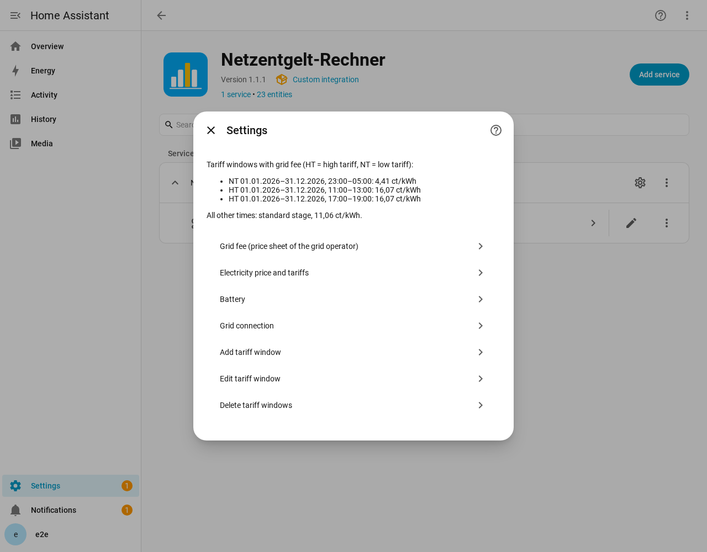
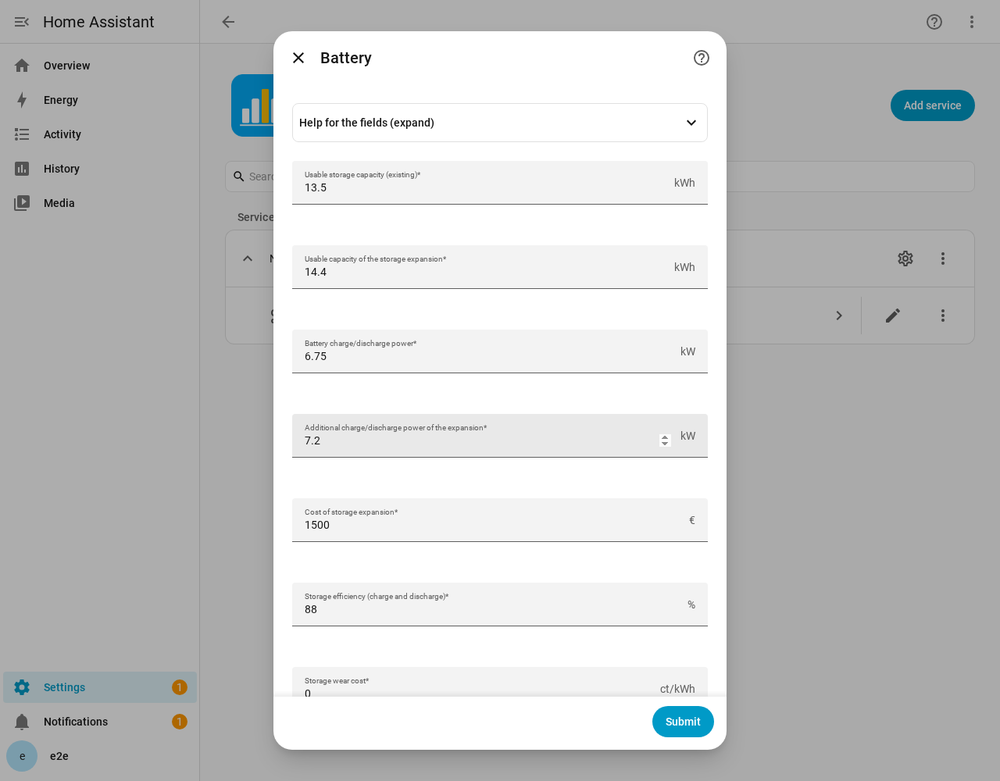
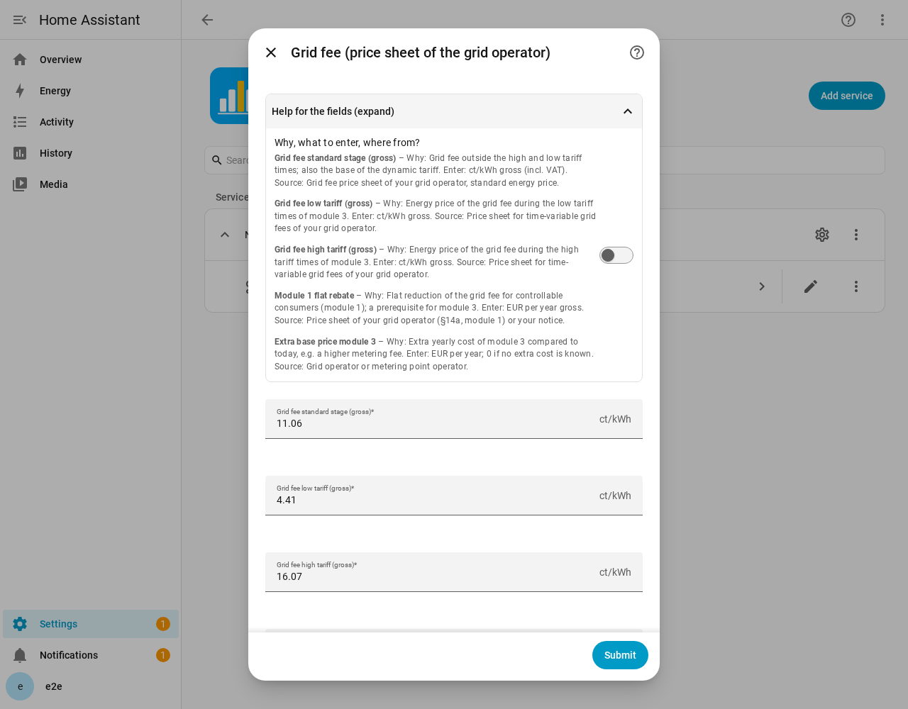
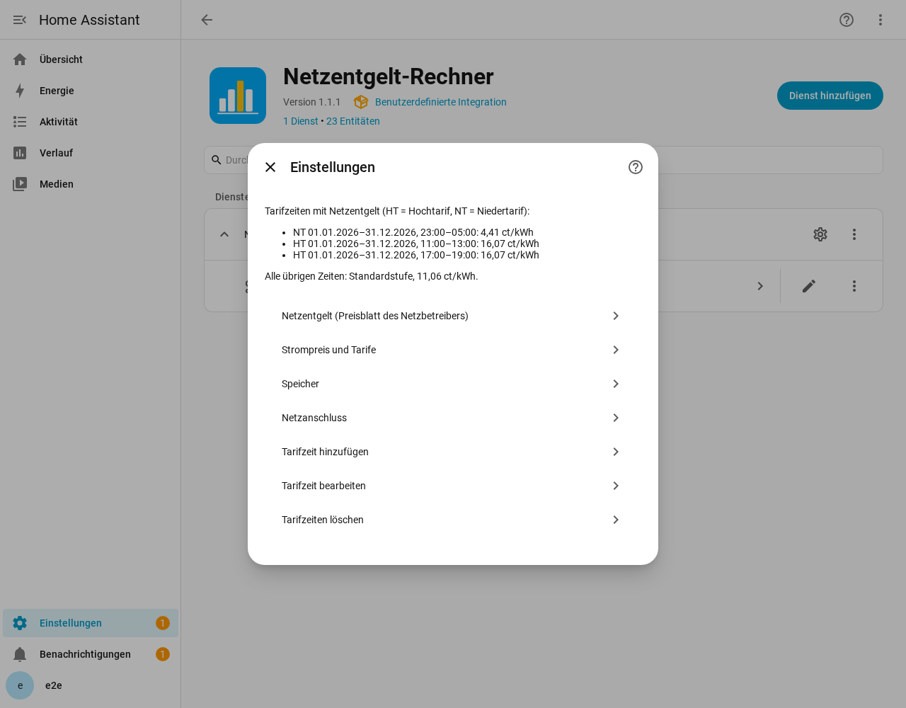
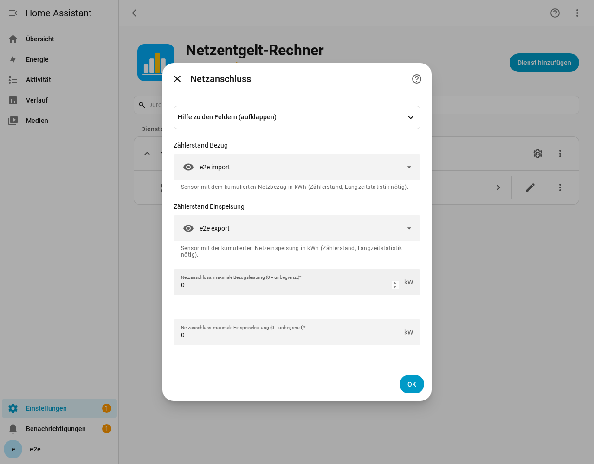
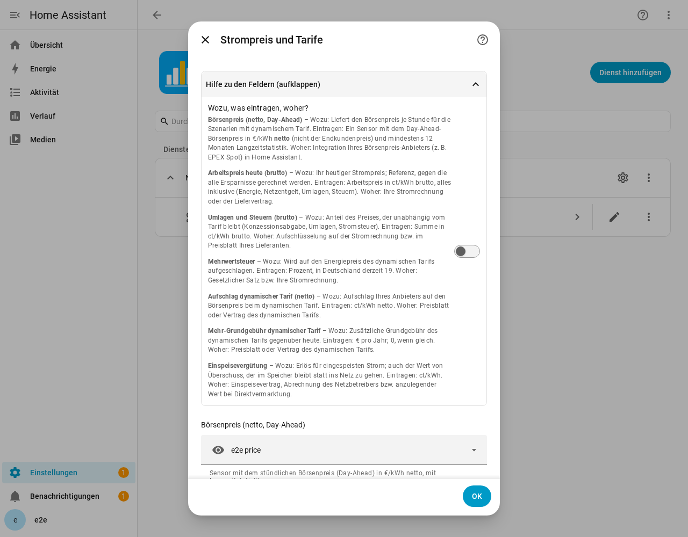
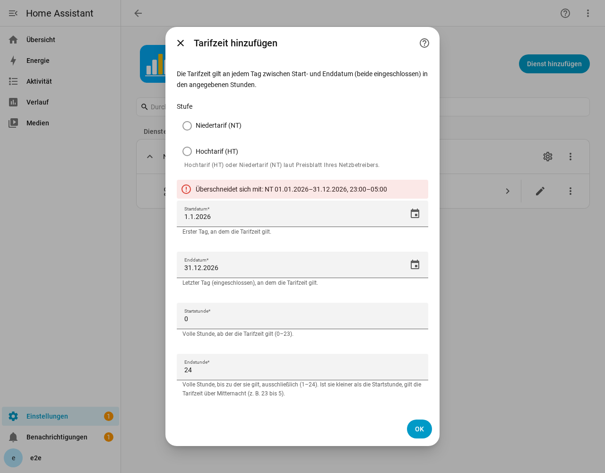

# Netzentgelt-Rechner (Home Assistant)

[Deutsch](#deutsch)

A Home Assistant custom integration for a PV system with battery storage. From your own long-term
statistics it calculates how much **§14a EnWG module 3** (time-variable grid fees), a **dynamic
electricity tariff**, their **combination** and a **storage extension** would save per year, and it
provides the current grid fee as **one sensor** with attributes (e.g. as input for an energy management system).

All figures are calculated locally from your data. No network access, no cloud, no extra dependencies.
Tariff values, levies and time windows are **editable assumptions** that you check against your own
grid operator's price sheet.

## Requirements

### Sensors in Home Assistant (required)

| Sensor | What it must provide |
|---|---|
| Meter reading **import** | Cumulative grid import in kWh (`state_class: total_increasing`) with long-term statistics |
| Meter reading **export** | Cumulative grid export (feed-in) in kWh (`total_increasing`) with long-term statistics |
| **Spot price** history | Hourly day-ahead price, net, in EUR/kWh, with long-term statistics (mean) |

At least **200 complete days** of statistics are needed. Home Assistant 2026.2.0 or newer.

### Information you have to look up yourself (not provided by the integration)

The integration ships only **example values**. Enter your own in the device's number entities
and in the options dialog:

- **Grid fees** of your grid operator (price sheet): standard, low and high tariff in ct/kWh gross,
  and the **time windows** for low and high tariff (dates and hours).
- **Module 1 flat rate** (EUR/year) and any extra base price for module 3.
- **Your current electricity price** (ct/kWh gross) and **levies and taxes** (ct/kWh gross).
- **Dynamic tariff:** supplier markup (ct/kWh net) and extra base fee (EUR/year).
- **Feed-in tariff** (ct/kWh).
- **Battery data:** usable storage capacity (kWh, without reserves and manufacturer limits), usable capacity of a planned
  extension (kWh), its cost (EUR), round-trip efficiency, charge/discharge power (kW, existing and added by
  the extension), wear cost.

## Installation

1. Click the badge above, or: HACS → three-dot menu → *Custom repositories* → add
   `https://github.com/principat/ha-netzentgelt-rechner` as category *Integration*.
2. Install *Netzentgelt-Rechner*, restart Home Assistant.
3. *Settings → Devices & services → Add integration → Netzentgelt-Rechner*; pick your import meter,
   export meter and spot price sensor.
4. Enter your values: *Configure* on the integration shows the tariff windows with their grid fees and one entry
   per topic: **Grid fee**, **Electricity price and tariffs** (incl. the spot price sensor), **Battery**, **Grid
   connection** (incl. the meters). Each topic starts with a collapsed help block that explains every field (why,
   what to enter, where to find it). Experienced users can also change the numbers directly in the device's number
   entities. Then press *Neu berechnen* (recalculate). The result appears in
   the *Wirtschaftlichkeit* (profitability) sensor; the current grid fee in the *Netzentgelt* sensor.

You can set the integration up **several times** (e.g. to compare different base data or locations); give each
instance its own name, it becomes the device name and part of the entity IDs. Calculations of all instances run one
after another.

### Screenshots

| Settings with tariff windows and fees | Battery (help collapsed) | Help block expanded |
|---|---|---|
|  |  |  |

License: MIT. Dashboard example: [`examples/en/dashboard.yaml`](examples/en/dashboard.yaml).

## Development

(German only.) Specification: `docs/01-fachliche-spezifikation.md`, technical: `docs/02-technische-spezifikation.md`,
tests: `docs/03-teststrategie.md`, release: `docs/04-release-workflow.md`, working agreement: `CLAUDE.md`.
Run tests with `python -m pytest`.

---

## Deutsch

Eine Home-Assistant-Custom-Integration für eine PV-Anlage mit Speicher. Sie berechnet aus Ihren
Langzeitstatistiken, wie sehr sich **§14a-EnWG-Modul 3** (zeitvariable Netzentgelte), ein **dynamischer
Stromtarif**, deren **Kombination** und eine **Speichererweiterung** pro Jahr lohnen, und stellt das
aktuelle Netzentgelt als **einen Sensor** mit Attributen bereit (z. B. für ein Energiemanagementsystem).

Alles wird lokal aus Ihren Daten gerechnet: keine Netzwerkzugriffe, keine Cloud, keine zusätzlichen
Abhängigkeiten. Tarifwerte, Umlagen und Tarifzeiten sind **editierbare Annahmen**, die Sie anhand des
Preisblatts Ihres Netzbetreibers prüfen.

### Voraussetzungen

#### Sensoren in Home Assistant (notwendig)

| Sensor | Was er liefern muss |
|---|---|
| Zählerstand **Bezug** | Kumulierter Netzbezug in kWh (`state_class: total_increasing`) mit Langzeitstatistik |
| Zählerstand **Einspeisung** | Kumulierte Netzeinspeisung in kWh (`total_increasing`) mit Langzeitstatistik |
| **Börsenpreis**-Verlauf | Stündlicher Day-Ahead-Preis, netto, in €/kWh, mit Langzeitstatistik (Mittelwert) |

Mindestens **200 vollständige Tage** Statistik sind nötig. Home Assistant 2026.2.0 oder neuer.

#### Informationen, die Sie selbst beschaffen müssen (liefert die Integration nicht)

Die Integration enthält nur **Beispielwerte**. Tragen Sie Ihre eigenen in den Zahlen-Entitäten des Geräts
und im Optionsdialog ein:

- **Netzentgelte** Ihres Netzbetreibers (Preisblatt): Standard-, Niedertarif und Hochtarif in ct/kWh brutto
  sowie die **Tarifzeiten** für Nieder- und Hochtarif (Datum und Stunden).
- **Modul-1-Pauschale** (€/Jahr) und ein eventueller Zusatz-Grundpreis für Modul 3.
- **Ihr heutiger Strompreis** (ct/kWh brutto) und **Umlagen und Steuern** (ct/kWh brutto).
- **Dynamischer Tarif:** Aufschlag des Lieferanten (ct/kWh netto) und Mehr-Grundgebühr (€/Jahr).
- **Einspeisevergütung** (ct/kWh).
- **Speicherdaten:** nutzbare Speicherkapazität (kWh, ohne Reserven und Herstellergrenzen), nutzbare Kapazität einer
  geplanten Erweiterung (kWh) und deren Kosten (€), Wirkungsgrad, Lade-/Entladeleistung (kW, vorhanden und zusätzlich durch die Erweiterung),
  Verschleißkosten.

### Installation

1. Auf das Badge oben klicken, oder: HACS → Menü (drei Punkte) → *Benutzerdefinierte Repositories* →
   `https://github.com/principat/ha-netzentgelt-rechner` als Kategorie *Integration* hinzufügen.
2. *Netzentgelt-Rechner* installieren, Home Assistant neu starten.
3. *Einstellungen → Geräte & Dienste → Integration hinzufügen → Netzentgelt-Rechner*; Bezugszähler,
   Einspeisezähler und Börsenpreis-Sensor wählen.
4. Ihre Werte eintragen: *Konfigurieren* an der Integration zeigt die Tarifzeiten mit ihrem Netzentgelt und je
   Thema einen Eintrag: **Netzentgelt**, **Strompreis und Tarife** (inkl. Börsenpreis-Sensor), **Speicher**,
   **Netzanschluss** (inkl. Zähler). Jedes Thema beginnt mit einem eingeklappten Hilfeblock, der jedes Feld erklärt
   (wozu, was eintragen, woher). Geübte Nutzer können die Zahlen auch direkt in den Zahlen-Entitäten des Geräts
   ändern. Dann *Neu berechnen* drücken. Das Ergebnis steht im Sensor *Wirtschaftlichkeit*, das
   aktuelle Netzentgelt im Sensor *Netzentgelt*.

Die Integration lässt sich **mehrfach einrichten** (z. B. um verschiedene Basisdaten oder Standorte gegenüberzustellen);
jede Instanz bekommt einen eigenen Namen, der zum Gerätenamen und Teil der Entitäts-IDs wird. Die Berechnungen aller
Instanzen laufen nacheinander.

#### Bildschirmfotos

| Einstellungen mit Tarifzeiten und Entgelten | Netzanschluss (Hilfe eingeklappt) | Hilfeblock aufgeklappt | Tarifzeit-Konflikt |
|---|---|---|---|
|  |  |  |  |

Lizenz: MIT. Dashboard-Beispiel: [`examples/de/dashboard.yaml`](examples/de/dashboard.yaml).

### Entwicklung

Spezifikation: `docs/01-fachliche-spezifikation.md`, technisch: `docs/02-technische-spezifikation.md`,
Tests: `docs/03-teststrategie.md`, Release: `docs/04-release-workflow.md`, Arbeitsweise: `CLAUDE.md`.
Tests mit `python -m pytest`.
